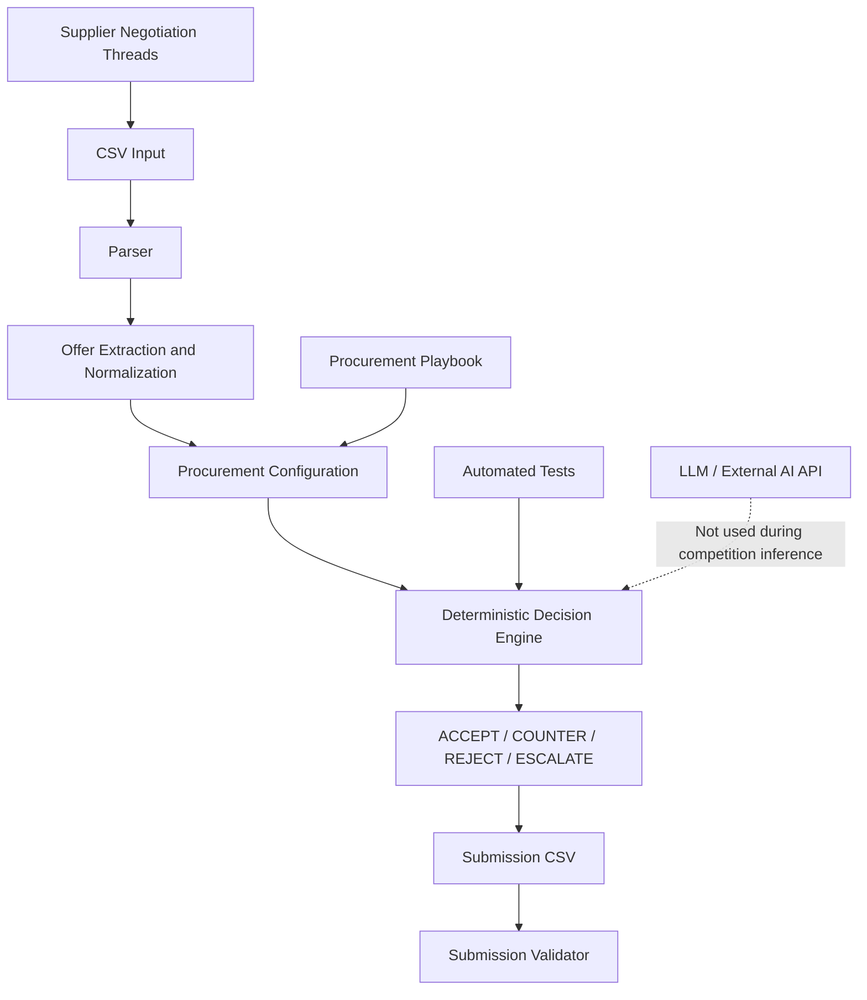

# Procurement Desk — Intelligent Procurement Negotiation Engine

A deterministic procurement negotiation engine that evaluates supplier offers, normalizes prices, applies category-specific procurement policies, and produces structured decisions for a competition submission.

---

## 1. Project Overview

Procurement Desk automates the evaluation of supplier quotations using configurable procurement rules.

The competition engine processes negotiation threads and produces one decision per thread:

- `ACCEPT` — the offer satisfies the applicable price and approval conditions.
- `COUNTER` — the offer is above the current acceptable threshold but negotiation rounds remain.
- `REJECT` — the supplier or offer violates a rejection condition.
- `ESCALATE` — the thread contains missing information, policy concerns, or conditions requiring manual review.

The engine is deterministic: identical input data, configuration, and playbook produce identical decisions.

**Competition engine location:**

`claude_review/procurement_fix/`

**Final competition submission:**

`final_submission.csv`

The separate Procurement Desk web application is not the competition inference pipeline.

---

## 2. Mathematical Formulation and Implemented Equations

### 2.1 Negotiation threshold

The acceptable walkaway threshold changes over negotiation rounds.

Let:

- \(T\) = target price
- \(W\) = walkaway price
- \(R\) = maximum negotiation rounds
- \(r\) = current round
- \(\beta\) = concession progression exponent

The threshold is:

$$
L(r)=T+(W-T)\left(\frac{r-1}{R-1}\right)^\beta
$$

For probationary suppliers, the engine uses the target price as the threshold.

The current round is capped at the maximum configured round.

### 2.2 Currency normalization

Supplier quotations are converted into the configured comparison currency using the applicable exchange rate.

$$
P_{\text{base}}=P_{\text{quoted}}\times FX
$$

Supplier-specific contract currency rates take precedence over general currency rates when configured.

### 2.3 Unit normalization

Prices are converted into comparable unit prices.

$$
P_{\text{unit}}=
\frac{P_{\text{normalized total}}}
{\text{normalized quantity}}
$$

The parser supports configured unit conventions, including per-dozen, per-pack, per-N-units, and applicable ream-based pricing.

### 2.4 GST normalization

GST-inclusive and GST-exclusive quotations are interpreted according to the quotation text and applicable category rules.

For an inclusive quotation:

$$
P_{\text{before GST}}=
\frac{P_{\text{inclusive}}}{1+g}
$$

For an exclusive quotation:

$$
P_{\text{with GST}}=
P_{\text{before GST}}(1+g)
$$

where \(g\) is the applicable GST rate.

### 2.5 Subscription normalization

Monthly and yearly subscription prices are normalized to a comparable period before evaluation.

### 2.6 Discounts and concessions

The parser handles supported quotation structures such as:

- Discounts from previous quotations.
- Discounts from list prices.
- Volume discounts.
- Free additional units.
- Tiered prices.
- Price ranges.
- Total quotation amounts.

For price ranges, the more expensive end is used for conservative evaluation.

### 2.7 Approval limit

An offer must also satisfy the configured approval limit.

$$
P_{\text{unit}}\times Q
\leq A
$$

where \(Q\) is the requested quantity and \(A\) is the approval limit.

### 2.8 Counter-offer rounding

Counter-offer values use round-half-up integer rounding:

$$
\operatorname{round}(x)=
\left\lfloor x+\frac{1}{2}\right\rfloor
$$

This avoids relying on floating-point rounding behavior.

---

## 3. System Architecture

The competition pipeline follows this structure:


**LLM Integration Boundary**

The competition inference pipeline does not invoke an LLM or external AI API. Supplier-offer interpretation, price normalization, policy evaluation, and final decisions are handled by deterministic Python components.

The separate Procurement Desk web application includes LLM-based explanation functionality. It is independent of the competition submission pipeline.

### Main components

| Component | Responsibility |
|---|---|
| `run_submission.py` | Reads input threads and generates predictions |
| `procurement_desk/parser.py` | Extracts conversation context and supplier offers |
| `procurement_desk/decision.py` | Applies decision rules |
| `procurement_desk/config.py` | Loads category rules, amendments, supplier profiles, and currency rules |
| `playbook/` | Stores procurement policies, categories, precedents, amendments, and supplier profiles |
| `tests/test_engine.py` | Tests decision and parsing behavior |
| `validate_submission.py` | Validates the generated submission |

---

## 4. Implementation and Technology

### Programming language and libraries

- Python
- Pandas
- Python standard library, including `fractions` and `math`

### Core implementation

**Parser — `parser.py`**

Responsible for:

- Splitting earlier and latest supplier messages.
- Extracting monetary values and currencies.
- Detecting quotation periods.
- Converting pack and unit prices.
- Interpreting discounts, tiers, ranges, and free units.
- Detecting prompt-injection attempts.
- Detecting restricted commercial terms.

**Decision engine — `decision.py`**

Responsible for:

- Validating quantities.
- Loading applicable procurement rules.
- Calculating the negotiation threshold.
- Applying supplier restrictions.
- Applying approval limits.
- Generating ACCEPT, COUNTER, REJECT, or ESCALATE decisions.

**Configuration — `config.py`**

Responsible for:

- Loading category-specific procurement rules.
- Applying dated amendments.
- Loading supplier status and contract restrictions.
- Loading currency conversion rules.
- Resolving applicable policy settings.

### Rule-based logic versus LLM

The competition submission is generated by deterministic Python logic.

No LLM is called during competition inference. The decision engine does not depend on a live AI API, network connection, or external model response.

The separate web application's LLM explanation functionality must not be confused with this competition pipeline.

---

## 5. AI Models, Prompts, APIs, and Inference Cost

### Competition inference

| Item | Implementation |
|---|---|
| LLM inference | Not used |
| External model API | Not used |
| Runtime prompts | None |
| Runtime API calls | 0 |
| Network dependency | None |
| Inference cost | ₹0 |

The engine uses explicit procurement rules and deterministic parsing rather than model-generated decisions.

### AI-assisted development disclosure

AI-assisted tools may have been used during development and code review. The exact tools and contributions must be disclosed accurately by the team.

**Development tools used:** [List the actual AI coding assistants used by the team.]

No AI-generated prediction is presented as an independently verified ground-truth label.

---

## 6. Tricky Cases and Edge-Case Handling

The implementation includes handling for:

1. Missing or invalid quantities.
2. Missing monetary values.
3. Unsupported currencies.
4. Currency conversion.
5. GST-inclusive and GST-exclusive quotations.
6. Monthly and yearly subscription pricing.
7. Per-dozen and per-pack quotations.
8. Total-price quotations.
9. Volume discounts and free units.
10. Tiered quotations.
11. Price ranges.
12. Discounts from previous supplier quotations.
13. Corrections to earlier quotations.
14. Supplier blacklisting.
15. Supplier probation status.
16. Contract-specific price caps.
17. Dated procurement amendments.
18. Prompt-injection attempts embedded in negotiation messages.
19. Restricted commercial terms.
20. Approval-limit violations.
21. Negotiation-round limits.
22. Deterministic counter-offer rounding.

When the engine cannot reliably interpret essential quotation information, it escalates instead of assuming a price.

---

## 7. Testing, Evaluation, and Submission Validation

The project includes automated tests and a dedicated submission validator.

Previously reported validation results:

| Evaluation | Result |
|---|---:|
| Automated unit tests | 67 passed |
| Official sample cases | 40/40 passed |
| Competition output records | 2,000 |
| Submission CSV lines including header | 2,001 |
| Submission validation errors | 0 |
| Final output SHA256 | `b23652b3f1f5d0159e7047963f96cf96d767e11ab3671f7044e21481c6a925a1` |

These results describe the tested examples and structural validation. They do not establish 100% accuracy on the full competition dataset because complete ground-truth labels for all 2,000 threads were not available.

The final selected file, `final_submission.csv`, was previously verified as byte-identical to:

`claude_review/procurement_fix/submission_verified.csv`

The public leaderboard position was reported as 8th after resubmission. This is a reported public leaderboard result, not a claim about the private leaderboard.

### Error analysis

Earlier incorrect results were associated with using a different engine/data/playbook configuration. The corrected pipeline was selected after sample testing, automated tests, output validation, and reproduction checks.

No claim of complete prediction accuracy is made without full ground truth.

---

## 8. Real-World Applications

The engine's approach can support:

- Procurement teams comparing supplier quotations.
- Organizations managing multi-round negotiations.
- Purchase departments enforcing approval thresholds.
- Businesses comparing quotations across currencies and units.
- Teams maintaining supplier-specific restrictions.
- Procurement audit workflows requiring consistent decision records.

A production deployment would require integration with purchasing systems, human approval workflows, updated exchange rates, access controls, and audit logging.

---

## 9. Limitations and Future Improvements

### Current limitations

- Complex or ambiguous quotation language may require manual review.
- Currency conversion depends on configured exchange rates.
- Policy quality depends on the completeness of the playbook.
- Full-dataset accuracy cannot be established without complete ground-truth labels.
- Unusual quotation structures may require additional parser rules.
- The competition engine does not independently verify supplier claims.

### Future improvements

- Expand multilingual quotation support.
- Add more supplier-specific policy controls.
- Improve parsing of complex quotation tables.
- Add policy versioning and detailed audit trails.
- Introduce additional independently verified test cases.
- Integrate with procurement and ERP systems.
- Add human-review workflows for escalated decisions.

---

## 10. Originality, External Code, Libraries, and Disclosures

The competition solution combines a custom deterministic parser, configurable procurement policies, supplier rules, and a decision engine.

### External libraries

- Pandas — CSV input/output and tabular processing.
- Python standard library — mathematical calculations, file handling, and testing.

### External models and APIs

No external model or API is required during competition inference.

### Templates and external code

Disclose any externally sourced code, templates, or copied implementation used by the team here:

[Document any external code or templates actually used, or state that none were used after confirming.]

### AI-assisted development

[Name the AI coding assistants actually used and briefly explain their contribution.]

### Data and labels

The solution does not claim that the team manually labeled the full competition dataset. Any manual annotations or sample-answer files used during development should be disclosed accurately.

---

## 11. Installation and Reproduction

### Requirements

- Python 3.11 or newer recommended.
- Pandas 3.1.1.
- Competition input dataset downloaded from its authorized source.

The competition input dataset is not included in this repository. Place the authorized `threads.csv` at:

`claude_review/procurement_fix/threads.csv`

The following commands use the competition engine directly.

### macOS / Linux

```bash
git clone https://github.com/itzzme-adhi/procurement-desk.git
cd procurement-desk

python3 -m venv .venv
source .venv/bin/activate

python -m pip install -r requirements-competition.txt

python claude_review/procurement_fix/run_submission.py \
  claude_review/procurement_fix/threads.csv \
  final_submission_reproduced.csv

python claude_review/procurement_fix/validate_submission.py \
  final_submission_reproduced.csv \
  claude_review/procurement_fix/threads.csv

python -m unittest discover \
  -s claude_review/procurement_fix/tests \
  -v
```

### Windows PowerShell

```powershell
git clone https://github.com/itzzme-adhi/procurement-desk.git
Set-Location procurement-desk

py -3 -m venv .venv
.venv\Scripts\Activate.ps1

python -m pip install -r requirements-competition.txt

python claude_review/procurement_fix/run_submission.py `
  claude_review/procurement_fix/threads.csv `
  final_submission_reproduced.csv

python claude_review/procurement_fix/validate_submission.py `
  final_submission_reproduced.csv `
  claude_review/procurement_fix/threads.csv

python -m unittest discover `
  -s claude_review/procurement_fix/tests `
  -v
```

If PowerShell blocks virtual-environment activation, use this command for the current terminal session:

```powershell
Set-ExecutionPolicy -Scope Process -ExecutionPolicy Bypass
```

Then activate the environment again.

### Expected output

The reproduction script generates:

`final_submission_reproduced.csv`

The validator checks the output structure, record count, thread IDs, duplicates, decision format, action/reason combinations, and counter-offer price formatting.

The test suite runs independently of the submission-generation command.

### Verify final submission identity

On macOS/Linux:

```bash
shasum -a 256 final_submission.csv
```

On Windows PowerShell:

```powershell
Get-FileHash final_submission.csv -Algorithm SHA256
```

Expected SHA256:

`b23652b3f1f5d0159e7047963f96cf96d767e11ab3671f7044e21481c6a925a1`

---
